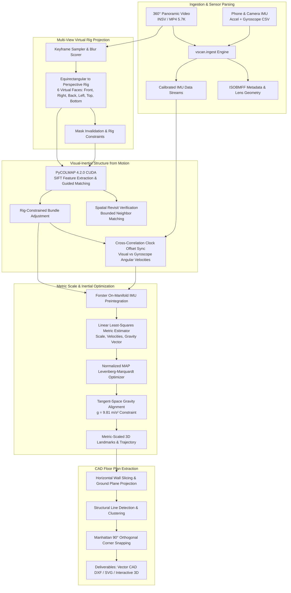

# Metric 360° Reconstruction & Architectural Floor Plan Pipeline

[](https://www.python.org/downloads/)
[-green.svg)](https://github.com/colmap/pycolmap)
[](https://gtsam.org/)
[](https://ubuntu.com/)
[](LICENSE)

An end-to-end, production-grade 3D computer vision and spatial computing pipeline that transforms **360° panoramic video** (Insta360) and **synchronized IMU telemetry** into **metric-accurate 3D reconstructions** and **vectorized 2D CAD architectural floor plans** with orthogonal Manhattan corner snapping.

---

## 🏗️ System Architecture



---

## 🌟 Key Engineering Features

### 1. `vscan` Production Core Architecture (`src/vscan/`)
- **Multi-View Rig Adapter**: Unwarps 360° equirectangular panoramas into calibrated 6-view virtual pinhole cameras with rigid baseline constraints, enabling standard perspective SfM engines to operate without spherical projection distortion.
- **Hardware-Accelerated PyCOLMAP 4.2.0**:
  - Direct integration with PyCOLMAP 4.2.0 with CUDA acceleration on single-GPU constraints (e.g., GTX/RTX).
  - Explicit multi-view rig definition enforcing fixed relative camera poses and known virtual intrinsics.
  - Bounded revisit matching to verify loop closures without computationally prohibitive all-pairs matching.
- **Sub-Millisecond Temporal Clock Synchronization**:
  - Recovers the temporal clock offset ($\Delta t$) between camera rolling shutters and phone/camera IMU clocks by computing the continuous cross-correlation of visual angular velocities ($\boldsymbol{\omega}_{\text{visual}}$) against gyroscope telemetry ($\boldsymbol{\omega}_{\text{gyro}}$).

### 2. Metric Scale Recovery & Floor Plan Engine (`v1/`)
- **Forster On-Manifold IMU Preintegration**:
  - Avoids re-integrating raw inertial measurements across optimization iterations using on-manifold $SO(3)$ preintegration with accelerometer and gyroscope bias tracking.
- **Normalized Maximum A Posteriori (MAP) Optimization**:
  - Joint Levenberg-Marquardt visual-inertial optimization balancing visual reprojection residuals against inertial motion constraints.
- **Metric SI Scale Factor Extraction**:
  - Solves monocular scale ambiguity by constraining the magnitude of the gravity vector to $\| \mathbf{g} \| = 9.81 \, \text{m/s}^2$ and estimating accelerometer bias in tangent space.
- **Manhattan 90° Corner Snapping**:
  - Automatically isolates interior structural walls, filters noise/furniture clutter, and snaps orthogonal walls to 90° angles to generate clean, architectural-grade vector CAD floor plans.

---

## 📁 Repository Structure

```
├── configs/                                 # Camera & hardware configuration profiles
│   ├── laptop.yaml                          # Compute budget (threads, GPU memory)
│   └── session.yaml                         # Survey session parameters
├── docs/                                    # Architectural specifications and contracts
│   ├── build_contract.md
│   ├── data_contracts.md
│   ├── job_lifecycle.md
│   └── projection_adapter.md
├── reports/                                 # Stage audit and validation reports
│   ├── 01_preflight.md
│   ├── 05_frames.md
│   ├── 06_sfm.md
│   └── 07_synchronization.md
├── src/vscan/                               # Core Python package (v0.2.0)
│   ├── cli.py                               # Typer CLI application entrypoint
│   ├── engine/                              # Process runner, supervisor, and telemetry
│   ├── frames/                              # Rig projection, lens masking, keyframe scoring
│   ├── ingest/                              # INSV/MP4 reader, ISOBMFF parser, camera geometry
│   ├── sfm/                                 # PyCOLMAP pipeline, rig BA, candidate matching
│   ├── storage/                             # SQLite artifact store and state tracking
│   └── sync/                                # Temporal alignment, clock sync, rotation gating
├── v1/                                      # Metric visual-inertial reconstruction pipeline
│   ├── src/
│   │   ├── alignment/                       # Gyro bias & linear scale initializer
│   │   ├── inertial/                        # Forster on-manifold IMU preintegration
│   │   ├── optimizer/                       # Normalized MAP Levenberg-Marquardt optimizer
│   │   └── visuals/                         # Wall extraction, 2D floor plans, 3D Plotly HUD
│   ├── scripts/
│   │   ├── run_high_resolution_pipeline.py  # Master end-to-end pipeline runner
│   │   ├── run_temporal_alignment.py        # Camera-IMU synchronization & calibration
│   │   └── generate_visual_results.py       # Visual asset generator
│   └── output/                              # Exported deliverables (PLY, SVG, HTML, CSV)
├── tests/                                   # Automated test suite (vscan package)
├── pyproject.toml                           # Package specification (Hatchling)
└── requirements.txt                         # Root dependencies
```

---

## 🚀 Quick Start Guide

### Prerequisites
- **OS**: Ubuntu 22.04 / 24.04 LTS (Native or Windows WSL2).
- **GPU**: NVIDIA GPU with CUDA 12.x support (4GB+ VRAM).
- **Python**: Python 3.11.x.

### 1. Environment Setup (WSL2 / Linux)

```bash
# Clone the repository
git clone https://github.com/rohitblpprajapat/floor-plan-project.git
cd floor-plan-project

# Create Python 3.11 virtual environment
python3.11 -m venv .venv
source .venv/bin/activate

# Install package and dependencies in editable mode
pip install --upgrade pip
pip install -e .
```

### 2. Run Automated Verification Tests

```bash
# Run vscan test suite
pytest tests/ -v

# Run v1 visual-inertial unit tests
pytest v1/tests/ -v
```

### 3. Running the Pipeline

#### A. Temporal Synchronization & Camera-IMU Calibration
```bash
python v1/scripts/run_temporal_alignment.py
```

#### B. Full Metric Reconstruction Pipeline
```bash
python v1/scripts/run_high_resolution_pipeline.py
```

#### C. Generate Vector CAD Floor Plans & 3D Web Viewer
```bash
python v1/scripts/generate_visual_results.py
```

---

## 📊 Exported Deliverables

| Deliverable | Format | Description |
| :--- | :---: | :--- |
| **Vector CAD Floor Plan** | `.svg` / `.json` | Architectural floor plan with Manhattan 90° corner snapping. |
| **Interactive 3D Viewer** | `.html` | Browser-based 3D scene visualizer (Plotly) with trajectory and landmarks. |
| **Metric 3D Point Cloud** | `.ply` | Metric-scaled 3D sparse landmark point cloud in physical meters (SI units). |
| **Camera Trajectory** | `.tum` / `.csv` | Time-stamped 6-DoF metric camera trajectory in TUM standard format. |
| **Diagnostic Plots** | `.png` | Scale stability curves, residual histograms, and clock sync cross-correlation. |

---

## 🔬 Mathematical Reference & Citations

- **IMU Preintegration**: Forster, C., Carlone, L., Dellaert, F., & Scaramuzza, D. (2017). *On-Manifold Preintegration for Real-Time Visual--Inertial Odometry*. IEEE Transactions on Robotics.
- **Structure from Motion**: Schönberger, J. L., & Frahm, J. M. (2016). *Structure-from-Motion Revisited*. Conference on Computer Vision and Pattern Recognition (CVPR).
- **Equirectangular Camera Model**: Caruso, D., Engel, J., & Cremers, D. (2015). *Large-scale direct SLAM for omnidirectional cameras*. IROS.

---

## 📄 License
This project is licensed under the MIT License — see the [LICENSE](LICENSE) file for details.
